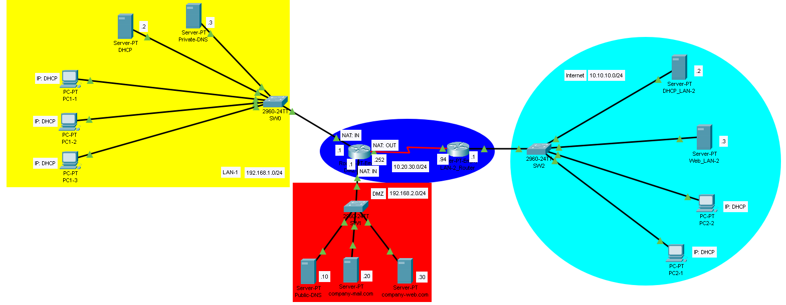

# DMZ-ACL_Network-Implementation

## Description
  This project demonstrates a small network simulated in Cisco Packet Tracer. It shows how to implement a DMZ and ACLs to protect both the internal LAN and DMZ servers. The lab also configures NAT and PAT so all internal hosts
and servers share a single public IP.

## Network Diagram

## Network Componets
| Component Type | Model                                      | Quantity |
|----------------|--------------------------------------------|----------|
| Switch         | Cisco 2960                                 | 3        |
| Router         | Cisco PT-Empty(1CGE/PT-ROUTER-NM-1S_ports) | 2        |
| PC             | Generic PC                                 | 5        |
| Server         | Cisco Server                               | 7        |

## IP Addressing Scheme
| Device            | Interface | IP Address   | Subnet Mask   | Default Gateway | DNS          | NAT     |
|-------------------|---------- |--------------|-------------- |-----------------|--------------|---------|
| SW0               |           |              |               |                 |              |         |
|   PC1-1           | F0/1      | DHCP         | 255.255.255.0 | 192.168.1.1     | 192.168.1.3  |         |
|   PC1-2           | F0/2      | DHCP         | 255.255.255.0 | 192.168.1.1     | 192.168.1.3  |         |
|   PC1-3           | F0/3      | DHCP         | 255.255.255.0 | 192.168.1.1     | 192.168.1.3  |         |
|   DHCP-Server     | F0/23     | 192.168.1.2  | 255.255.255.0 | 192.168.1.1     | 192.168.1.3  |         |
|   Private-DNS     | F0/24     | 192.168.1.3  | 255.255.255.0 | 192.168.1.1     |              |         |
| SW0               |           |              |               |                 |              |         |
|   Public-DNS      | F0/1      | 192.168.2.10 | 255.255.255.0 | 192.168.2.1     |              |         |
|   Company-mail    | F0/2      | 192.168.2.20 | 255.255.255.0 | 192.168.2.1     | 192.168.2.10 |         |
|   Company-web     | F0/3      | 192.168.2.30 | 255.255.255.0 | 192.168.2.1     | 192.168.2.10 |         |
| SW0               |           |              |               |                 |              |         |
|   PC2-1           | F0/1      | DHCP         | 255.255.255.0 | 10.10.10.1      | 192.168.2.10 |         |
|   PC2-2           | F0/2      | DHCP         | 255.255.255.0 | 10.10.10.1      | 192.168.2.10 |         |
|   DHCP_LAN-2      | F0/23     | 10.10.10.2   | 255.255.255.0 | 10.10.10.1      | 192.168.2.10 |         |
|   Web_LAN-2       | F0/24     | 10.10.10.3   | 255.255.255.0 | 10.10.10.1      | 192.168.2.10 |         |
| DMZ_Router        | G0/0      | 192.168.1.1  | 255.255.255.0 |                 |              | Inside  |
| DMZ_Router        | G1/0      | 192.168.2.1  | 255.255.255.0 |                 |              | Inside  |
| DMZ_Router        | S9/0      | 10.20.30.252 | 255.255.255.0 |                 |              | Outside |
| LAN-2_Router      | S9/0      | 10.20.30.94  | 255.255.255.0 |                 |              |         |
| LAN-2_Router      | G0/0      | 10.10.10.1   | 255.255.255.0 |                 |              |         |

## Configuration Details
### DHCP-Server(LAN-1)
* pool LAN-1
* Default Router: 192.168.1.1
* DNS: 192.168.1.3
* Starting IP: 192.168.1.10
* Subnet: 255.255.255.0

### DHCP-Server(LAN-2)
* pool LAN-2
* Default Router: 10.10.10.1
* DNS: 192.168.2.10
* Starting IP: 10.10.10.10
* Subnet: 255.255.255.0

### Private DNS
* company-web.com, ip: 192.168.2.30
* web-lan-2.com, ip: 10.10.10.3

### Public DNS
* company-web.com, ip: 10.20.30.252
* web-lan-2.com, ip: 10.10.10.3

### DMZ_Router
Router> enable

Router# conf t

Router(config)# hostname DMZ_Router

DMZ_Router(config)# interface G0/0

DMZ_Router(config-if)# ip address 192.168.1.1 255.255.255.0

DMZ_Router(config-if)# ip nat inside

DMZ_Router(config-if)# description LAN-1

DMZ_Router(config-if)# no shutdown

DMZ_Router(config-if)# exit

DMZ_Router(config)# interface G1/0

DMZ_Router(config-if)# ip address 192.168.2.1 255.255.255.0

DMZ_Router(config-if)# ip nat inside

DMZ_Router(config-if)# description DMZ

DMZ_Router(config-if)# no shutdown

DMZ_Router(config-if)# exit

DMZ_Router(config)# interface S9/0

DMZ_Router(config-if)# ip address 10.20.30.252 255.255.255.0

DMZ_Router(config-if)# ip nat outside

DMZ_Router(config-if)# description Internet

DMZ_Router(config-if)# no shutdown

DMZ_Router(config-if)# exit

DMZ_Router(config)# ip access-list extended DMZ_IN

DMZ_Router(config-ext-nacl)# permit udp any host 192.168.2.10 eq 53

DMZ_Router(config-ext-nacl)# permit tcp any host 192.168.2.10 eq 53

DMZ_Router(config-ext-nacl)# permit tcp any host 192.168.2.20 eq 25

DMZ_Router(config-ext-nacl)# permit tcp any host 192.168.2.20 eq 587

DMZ_Router(config-ext-nacl)# permit tcp any host 192.168.2.20 eq 110

DMZ_Router(config-ext-nacl)# permit tcp any host 192.168.2.20 eq 995

DMZ_Router(config-ext-nacl)# permit tcp any host 192.168.2.30 eq 80

DMZ_Router(config-ext-nacl)# permit tcp any host 192.168.2.30 eq 443

DMZ_Router(config-ext-nacl)# deny ip any any

DMZ_Router(config-ext-nacl)# exit

DMZ_Router(config)# ip access-list extended DMZ_OUT

DMZ_Router(config-ext-nacl)# permit udp host 192.168.2.10 any

DMZ_Router(config-ext-nacl)# permit tcp host 192.168.2.10 any

DMZ_Router(config-ext-nacl)# permit tcp host 192.168.2.20 any

DMZ_Router(config-ext-nacl)# permit tcp host 192.168.2.30 any

DMZ_Router(config-ext-nacl)# deny ip any any

DMZ_Router(config-ext-nacl)# exit

DMZ_Router(config)# permit access-list extended LAN-1_IN

DMZ_Router(config-ext-nacl)# permit tcp any any

DMZ_Router(config-ext-nacl)# permit udp any any

DMZ_Router(config-ext-nacl)# deny ip any any

DMZ_Router(config-ext-nacl)# exit

DMZ_Router(config)# permit access-list extended LAN-1_OUT

DMZ_Router(config-ext-nacl)# permit tcp any any

DMZ_Router(config-ext-nacl)# permit udp any any

DMZ_Router(config-ext-nacl)# deny ip any any

DMZ_Router(config-ext-nacl)# exit

DMZ_Router(config)# access-list 1 permit 192.168.1.0 0.0.0.255

DMZ_Router(config)# interface G0/0

DMZ_Router(config-if)# ip access-group LAN-1_IN in

DMZ_Router(config-if)# ip access-group LAN-1_OUT out

DMZ_Router(config-if)# exit

DMZ_Router(config)# interface G1/0

DMZ_Router(config-if)# ip access-group DMZ_IN out

DMZ_Router(config-if)# ip access-group DMZ_OUT in

DMZ_Router(config-if)# exit

DMZ_Router(config)# ip nat inside source list 1 interface S9/0 overload

DMZ_Router(config)# ip nat inside source static udp 192.168.2.10 53 10.20.30.252 53

DMZ_Router(config)# ip nat inside source static tcp 192.168.2.10 53 10.20.30.252 53

DMZ_Router(config)# ip nat inside source static tcp 192.168.2.20 25 10.20.30.252 25

DMZ_Router(config)# ip nat inside source static tcp 192.168.2.20 587 10.20.30.252 587

DMZ_Router(config)# ip nat inside source static tcp 192.168.2.20 110 10.20.30.252 110

DMZ_Router(config)# ip nat inside source static tcp 192.168.2.20 995 10.20.30.252 995

DMZ_Router(config)# ip nat inside source static tcp 192.168.2.30 80 10.20.30.252 80

DMZ_Router(config)# ip nat inside source static tcp 192.168.2.30 443 10.20.30.252 443

DMZ_Router(config)# ip route 10.10.10.0 255.255.255.0 10.20.30.94

DMZ_Router(config)# exit

DMZ_Router# copy running-config startup-config

DMZ_Router# exit

### LAN-2_Router
Router> enable

Router# conf t

Router(config)# hostname LAN-2_Router

LAN-2_Router(config)# interface G0/0

LAN-2_Router(config-if)# ip address 10.10.10.1 255.255.255.0

LAN-2_Router(config-if)# description LAN-2

LAN-2_Router(config-if)# no shutdown

LAN-2_Router(config-if)# exit

LAN-2_Router(config)# interface S9/0

LAN-2_Router(config-if)# ip address 10.20.30.94 255.255.255.0

LAN-2_Router(config-if)# description Company-LAN

LAN-2_Router(config-if)# no shutdown

LAN-2_Router(config-if)# exit

LAN-2_Router(config)# exit

LAN-2_Router# copy running-config startup-config

LAN-2_Router# exit

## Test Scenarious
To ensure connectivity and functionality, the following tests were performed:

  * HTTP/HTTPS Connections: All hosts within both LANs were able to connect to DMZ web-server via HTTP and HTTPS.
  * Mail tests: All PCs got mail client configured and were able to communicate via SMTP and POP3.
  * Access-list: All unwanted connections like ICMP weren't able to go through.
  * NAT and PAT: Private IP were successfully translated into public one with their respected ports.

## Conclusion
  The project meets its objectives and requirements. All hosts can communicate with each other. Servers in the DMZ are reachable from outside while protected by ACLs. NAT translations are configured correctly, allowing all
LAN hosts to share a single public IP address.

## License
This project is licensed under the CC0-1.0 Universal - see the LICENSE file for details.
